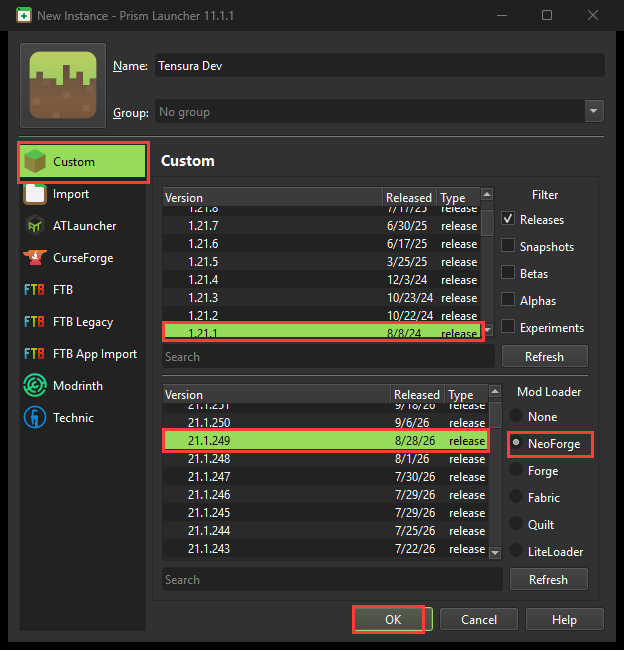
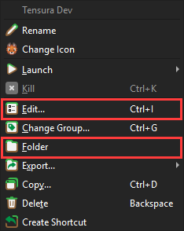
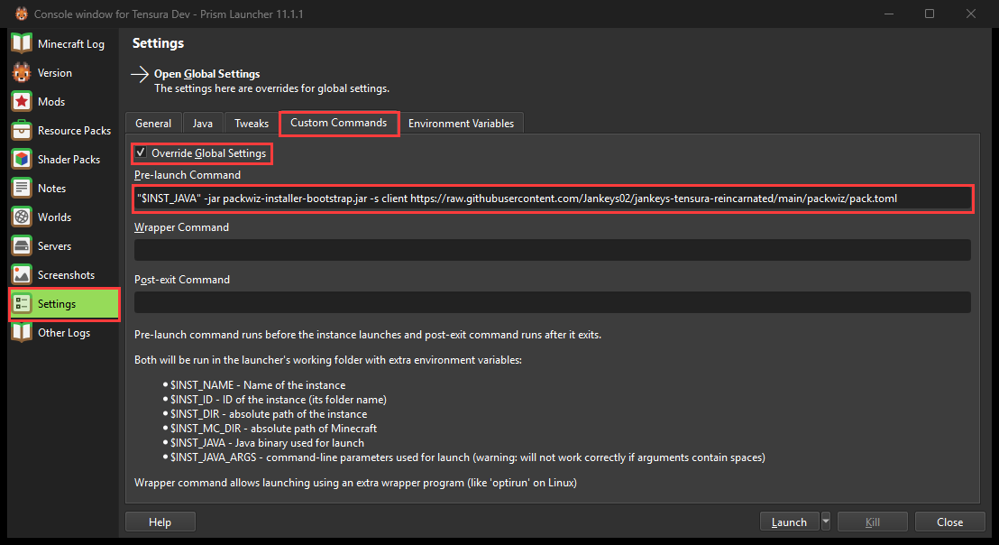
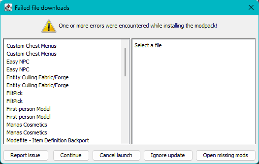

# Working on the pack together

How this repo works, how to get it onto your machine, and how to stay in sync while developing.

## How it works

There are two separate things, and they travel by different routes:

| What | Where it lives | How it reaches you |
|------|----------------|--------------------|
| **Configs, quests, KubeJS scripts, docs** | This Git repo | `git pull` |
| **Mod jars** (the `.jar` files in `mods/`) | CurseForge | The CurseForge app installs and updates them |

**Mod jars are not in the repo.** `git pull` never adds, removes or updates a mod. If a change needs a new mod, the person who made it must say so (in the commit message, the CHANGELOG, or a message), and everyone installs it themselves.

## Which setup to use

| Who | Setup | Mods come from |
|-----|-------|----------------|
| **Players** | CurseForge app, install the published pack | The CurseForge pack (built from `packwiz/` on every release) |
| **Developers** (anyone who changes the pack) | A separate **Prism Launcher** instance, see "Automatic mod sync" below | `packwiz/` on `main`, installed automatically at every launch |
| **Server** | packwiz installer, see "Server pack" below | `packwiz/`, with `-s server` |

Why developers use Prism: the packwiz installer and the CurseForge app both manage `mods/`, so they must not share a folder. With Prism every developer gets exactly the mods listed on `main` (or on a branch under test) without installing anything by hand. CurseForge stays the way players get the pack; developers keep a CurseForge instance only to test the finished release zip the way a player would.

The repo is laid out like a Minecraft *instance folder* (the folder holding `mods`, `config`, `saves`). So the repo root and the instance folder are the same place.

## One-time setup

You need the pack installed first, so you have the right mods.

1. Install the pack from CurseForge (or ask for the mod list if it isn't published yet).
2. Install [Git](https://git-scm.com) if you don't have it.
3. Close Minecraft.
4. In the CurseForge app, click the three dots (⋯) on the pack, then **Open Folder**.
5. **Back up first:** copy the `config` folder somewhere safe. The next step overwrites it.
6. Click the address bar of that folder window, type `cmd`, press Enter. A terminal opens in the folder.
7. Run these one at a time:

```bash
git init
git remote add origin https://github.com/Jankeys02/jankeys-tensura-reincarnated.git
git fetch origin
git checkout -f -B main origin/main
```

`checkout -f` replaces files that share a name with repo files (like `config/`). Your mods, saves and screenshots are untouched, because the repo doesn't contain them.

## Staying up to date

Before you start working each session:

```bash
git pull origin main
```

If Git refuses because you changed a file yourself, either commit your change (see below) or run `git stash` to set it aside, pull, then `git stash pop` to bring it back.

## Developing: the daily loop

1. **Pull** the latest (above).
2. **Make a branch** for your work, so `main` stays stable:
   ```bash
   git checkout -b my-change-name
   ```
3. **Edit and test in-game.** Launch the pack and check your change works.
4. **See what you changed:**
   ```bash
   git status
   ```
5. **Commit** (save a snapshot) only the files you meant to change:
   ```bash
   git add config/ftbquests kubejs
   git commit -m "Short description of what and why"
   ```
6. **Push** your branch to GitHub:
   ```bash
   git push -u origin my-change-name
   ```
7. **Open a Pull Request** on GitHub (the "Compare & pull request" button). The owner reviews it and merges it into `main`.

Outside collaborators can't push to this repo directly. They **fork** it (GitHub's Fork button), push to their fork, and open the Pull Request from there. See [CONTRIBUTING.md](CONTRIBUTING.md).

## Mods and the server pack (packwiz)

The mod list lives in [packwiz/](packwiz/) as one small text file per mod (name, exact file, CurseForge project and file ID, and which side it belongs to: `client` or `both` or `server`). It is the single source of truth for the client pack **and** the server pack, and Git shows exactly which mods were added, removed or updated in every commit. [packwiz/README.md](packwiz/README.md) has the commands.

**Adding, removing or updating a mod** (everyone, in a branch / Pull Request):

1. Install [packwiz](https://packwiz.infra.link) once (`go install github.com/packwiz/packwiz@latest`, or download the Windows build from its GitHub).
2. In the `packwiz/` folder run `packwiz curseforge add <CurseForge mod URL>`.
3. Open the new `mods/<name>.pw.toml`. If the mod is visual/HUD/sound/minimap only, set `side = "client"`. Otherwise leave `both`. If unsure, leave `both` and test the server.
4. Run `packwiz refresh`, then commit `packwiz/` together with that mod's `config/` files and a `CHANGELOG.md` line.
5. Use the CurseForge app as normal to install the same mod in your own game and test it.

`packwiz curseforge add` also adds the mod's required libraries. Removing: `packwiz remove <name>`. Updating everything: `packwiz update --all`.

**After pulling** (everyone else): `git pull`. On Prism the mods update by themselves at the next launch. On a CurseForge instance, look at what changed with `git diff --stat HEAD@{1} -- packwiz/mods`: new files there are new mods to install in the CurseForge app, removed files are mods to delete.

**Do not run the packwiz installer on a CurseForge instance.** The CurseForge app and the installer both manage `mods/` and will overwrite each other, which leaves duplicate or missing mods. The installer is for Prism/MultiMC instances and servers.

### Automatic mod sync (Prism Launcher / MultiMC)

Use a separate Prism instance, never the CurseForge one. Mods then follow `packwiz/` without any manual install. Tested on 2026-10-15: after the blocked files are in place, the instance installs and starts. If a step differs on your machine, fix this section in your Pull Request.

1. In Prism click **Add Instance**, choose **Custom**, set a name (for example `Tensura Dev`), Minecraft `1.21.1` and NeoForge `21.1.249`, then **OK**.

   

2. Download `packwiz-installer-bootstrap.jar` from the [packwiz-installer-bootstrap releases](https://github.com/packwiz/packwiz-installer-bootstrap/releases) and put it in the instance's game folder: right-click the instance, **Folder**, then open `minecraft` (or `.minecraft`).

   

3. Right-click the instance, **Edit...**, **Settings**, tab **Custom Commands**. Tick **Override Global Settings** and set **Pre-launch Command** to:
   ```
   "$INST_JAVA" -jar packwiz-installer-bootstrap.jar -s client https://raw.githubusercontent.com/Jankeys02/jankeys-tensura-reincarnated/main/packwiz/pack.toml
   ```

   

4. Set up the repo in that same game folder as in "One-time setup" above, so `git pull` brings configs and quests.

Every launch now adds, removes and updates the mods to match `main`. Details:

- **Your own mod changes:** after `packwiz curseforge add` and `packwiz refresh`, push your branch. To test it before the merge, change `main` in the Pre-launch URL to your branch name (change it back afterwards). The URL only sees what is pushed to GitHub.
- **Blocked mods:** 20 files (see the list below) can't be downloaded by the installer, so on the first launch it shows a "Failed file downloads" window and installs nothing until they are in place. Easiest: copy them from a CurseForge instance of the pack (same folder names: `mods` and `resourcepacks`), or click **Open missing mods** and download them yourself. Then launch again; the installer leaves them alone afterwards. Never click **Ignore update**, it skips the whole sync.

  
- **Client-only mods** (`side = "client"`) are installed because of `-s client`. Mods marked `server` are skipped.
- **Worlds:** copy a world from the CurseForge instance's `saves/` folder if you want to keep it.
- **Releases:** player-facing releases still go through CurseForge (see "Releasing"). Before a release, install the zip in a CurseForge instance once and check it starts.

**Blocked files** (their authors block downloads outside CurseForge; the CurseForge app downloads them normally):

- Client and server need these **6 mods**: Custom Chest Menus, Easy NPC, FiltPick, Tensura: Better Subordinates, Tensura: Enigmatic, Tensura: Unique Monsters. For a server, see SERVER_HOSTING.md.
- Client only, **8 more mods**: Entity Culling, First-person Model, Manas Cosmetics, Modefite, Not Enough Animations, Skin Layers 3D, Talking Heads, The Immersive Music Mod.
- Client only, **6 resource packs** (go in `resourcepacks`): Drigo 3D Lantern's x Punchy, Fresh Animations, Fresh Animations: Extensions, Fyoncle's 3D Trims, Refined Buckets, Refined Torches.

The list was read from the installer's error window on 2026-10-15. When you add a mod, the installer tells you if it is blocked; add it here.

## Server pack

The server is built from the same `packwiz/` list. Mods marked `client` are left out; Chunky (server-only) is marked `server`. Hosts: see [SERVER_HOSTING.md](SERVER_HOSTING.md).

On a server machine with the NeoForge 21.1.249 server installed:

```bash
java -jar packwiz-installer-bootstrap.jar -g -s server https://raw.githubusercontent.com/Jankeys02/jankeys-tensura-reincarnated/main/packwiz/pack.toml
```

Run it again after every pack update; it adds, removes and updates the server's mods to match. Then add the six blocked server mods by hand (list above; the client-only ones are not needed). `config/`, `kubejs/` and `defaultconfigs/` still come from this repo, as before.

Every client release should come with a matching server update, so versions match. Players on a different version than the server get a mod-mismatch error when joining.

## Where things are

- `config/ftbquests/quests/chapters/*.snbt` — one file per quest chapter
- `config/ftbquests/quests/lang/en_us.snbt` — quest text (titles, descriptions)
- `config/ftbquests/quests/data.snbt` — quest book settings
- `kubejs/` — scripts and resource overrides
- `defaultconfigs/` — defaults applied to new worlds
- `CHANGELOG.md` — what changed per release
- `packwiz/` — the mod list (see "Mods and the server pack" above); `server/` — files for the server zip
- `SERVER_HOSTING.md` — hosting guide for server owners; `SERVER_PACK.md` — old server build history
- `RELEASE_GUIDE.md`, `PACK_DESCRIPTION.md` — how to release, and the CurseForge page text

## Tips and gotchas

- **Editing quests in-game** (the FTB Quests editor) writes straight to the `.snbt` files. Those edits show up in `git status`; commit them like any other change.
- **Two people editing the same quest chapter** will cause a *merge conflict* (Git can't combine both edits). Keep one person per chapter at a time, and pull before you start.
- **Don't commit** worlds (`saves/`), `logs/`, `crash-reports/`, screenshots, or anything with your username or account tokens. These are meant to stay local; if `git status` lists them, leave them out of `git add`.
- **Config files rewrite themselves.** Mods often rewrite their own config when the game starts, so `git status` can show changes you didn't make (for example `DistantHorizons.toml`). Only commit the ones you changed on purpose.
- **Adding or removing a mod?** Say so clearly in your commit/PR and in `CHANGELOG.md`, since Git can't carry the jar. The release maintainer updates the CurseForge pack.

## Releasing (owner)

Versions follow [SemVer](https://semver.org/): `MAJOR.MINOR.PATCH`.

1. Bump `version` in `package.json`.
2. Move the `[Unreleased]` items in `CHANGELOG.md` into a dated version section.
   Write it for players, and put the server notes under a `### Server pack` heading in that same section. Everything above that heading is the client changelog.
3. Commit, then tag and push:
   ```bash
   git tag v1.2.0
   git push origin main --tags
   ```
4. GitHub builds the zips and puts the client and server changelogs in the release notes (also as `changelog-client.md` and `changelog-server.md` under Assets). Upload the client zip and the server zip to CurseForge and paste each changelog. See [RELEASE_GUIDE.md](RELEASE_GUIDE.md).
